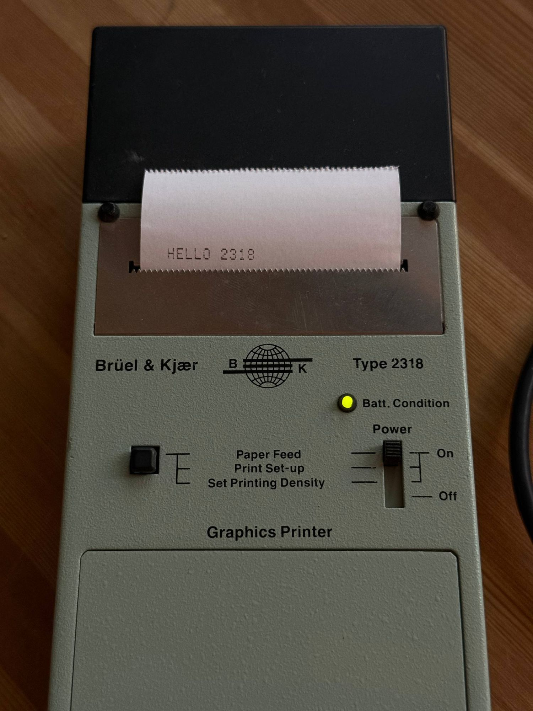
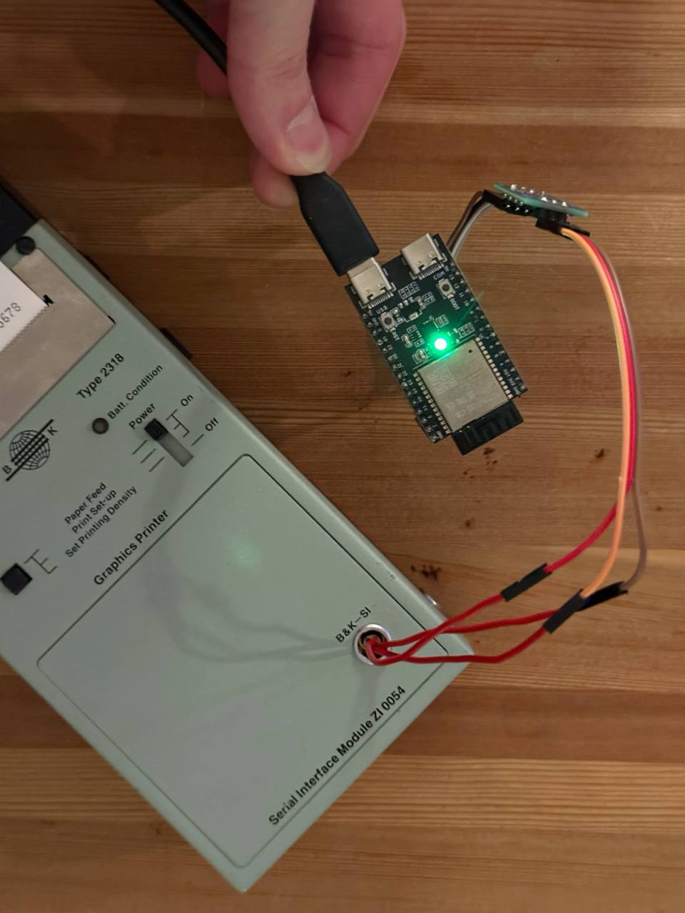
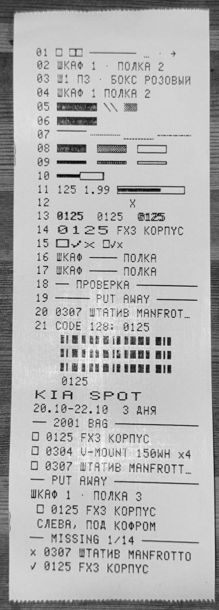
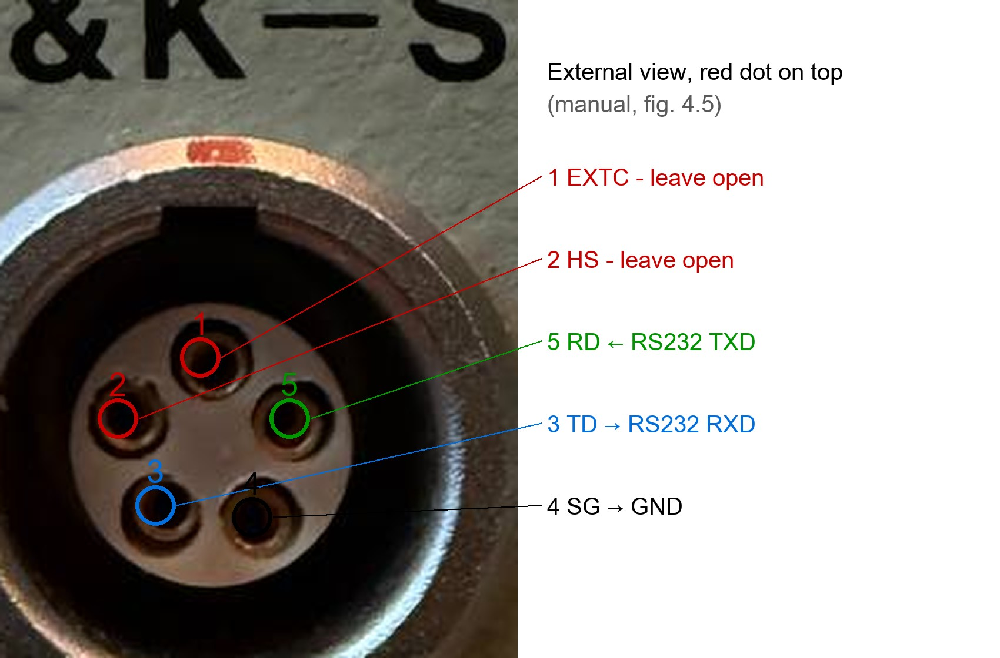

# B&K 2318 thermal printer + ESP32-C6

Notes, firmware and probe scripts for driving a **Bruel & Kjaer Type 2318** graphics printer (a portable thermal printer from the late 1980s) with its **ZI 0054** serial interface module from a modern computer. The printer is not modified: a small external adapter plugs into its B&K-SI socket.

```
computer USB -> ESP32-C6 + SP3232 RS-232 -> LEMO 5-pin B&K 2318 printer
```

<table>
  <tr>
    <td width="50%"></td>
    <td width="50%"></td>
  </tr>
  <tr>
    <td>The 2318 with the ZI 0054 module, first line printed from the ESP32-C6.</td>
    <td>The adapter: MuseLab nanoESP32-C6, an SP3232 RS-232 module, and resistor legs in the B&K-SI socket instead of a LEMO plug.</td>
  </tr>
</table>

Everything here was measured on one printer, SN 1941478 with PROM VP1915, unless marked otherwise. If yours behaves differently, please open an issue.

## About the printer

The **Type 2318 Graphics Printer** was made in Denmark by Bruel & Kjaer, the maker of sound and vibration instruments. It is a battery-powered companion for B&K sound level meters and analysers (2231, 2236, 2239, 2260, 4436 and others): plug it in, press print on the instrument, and get a paper record of the measurement in the field. Our copy of the manual is dated June 1988.

- **Print:** thermal, a single column of 7 dots on a moving carriage, 0.8 lines per second.
- **Paper:** 58 mm roll, about 15 m (about 4000 lines). A normal 57 mm till roll works.
- **Text:** 24 characters per line, or 12 in double width; inverse video; left or right alignment.
- **Character sets:** 11 in ROM (US ASCII, English, German, French, Spanish, Italian, Swedish, Danish/Norwegian, Russian KOI-7, Greek, Japanese katakana), plus a rune set that the manual does not mention, and 96 user-defined 7x7 characters.
- **Graphics:** a 168-dot line with commands for lines, bars, dot columns and cursor moves, used by the instruments to print bar charts next to the numbers.
- **Interface:** the plug-in ZI 0054 module holds the microcontroller (an RCA 1805) and the firmware, and gives a serial port, B&K-SI, on a 5-pin LEMO socket: RS-232 style, 50 to 19200 baud, XON/XOFF and a READY/BUSY line, about 7 KB of buffer.
- **Power:** 4 x 1.25 V NiCd cells, 0.5 Ah, 1000 to 2000 lines per charge.
- **Size:** 202 x 85 x 52 mm, about 1 kg.

They still turn up on auction sites, often without cables or a manual; ours cost $15. With an adapter they make a nice little receipt printer.

## What works

- **Text:** 24 characters per line (12 wide), wide, inverse, right alignment; Latin, Russian (uppercase), Greek, katakana and the hidden rune set are all in ROM.
- **Own characters (DRC):** 96 user-defined 7x7 glyphs. We use them for a check mark, a cross, a tick box, arrows, an ellipsis, and a full lowercase Cyrillic set.
- **PDI graphics:** lines, bars, dot columns, text at any dot position. Bold by overprinting, Code 128 barcodes that a scanner reads, divider tiles.
- **Adapter firmware v2:** print jobs over USB that print completely or not at all, a check that the printer is on, built-in glyphs, cancel within a line or two. A Python client is included.

<table>
  <tr>
    <td width="50%"></td>
    <td width="50%"></td>
  </tr>
  <tr>
    <td>A probe strip: own glyphs, PDI lines and bars, overlaid bars, bold by overprinting, wide and normal text in one line, a Code 128 barcode, and a mock receipt.</td>
    <td>The B&K-SI socket from the outside. Only pins 3, 4 and 5 are needed.</td>
  </tr>
</table>

## Things worth knowing before you start

- **Power only from batteries.** Without batteries, never put more than 6 V on the power socket: the original mains adaptor can burn the head (FrodeM's warning; `docs/hardware.md`).
- **Check the backup NiCd cells** under the ZI 0054 module. Both of ours had leaked, and so had FrodeM's.
- **XON/XOFF arrive as 0x91/0x93** on an 8N1 receiver when the printer is in its factory 7-bit mode. Mask with `& 0x7F`, or flow control never triggers.
- **Keep bytes >= 0x80 out of the text.** In 7-bit mode bit 7 is dropped, so a UTF-8 byte 0x9F becomes 0x1F, a full reset. Bytes `04 0E 0F 19 1B 1D 1F` are commands; `0E` turns everything after it into graphics.
- **A printer that is off looks like one that is on**: bytes just vanish. NSR (`1F`) makes it answer XOFF + XON within about 11 ms, which is a cheap power check.
- **CR right after LF (and LF after CR) is ignored.** The last printed line stays under the head until two more lines are fed.
- **Faint print is usually old paper.** A fresh 57 mm till roll fixed ours.
- **Inverse is hard to read** (1-dot white strokes) and doesn't affect graphics. There is a white gap between print lines, so images come out striped.

## Contents

| Path | What |
|---|---|
| `docs/hardware.md` | printer, specs, power, paper, head, inside the ZI 0054 |
| `docs/wiring.md` | B&K-SI socket pinout, levels, ESP32-C6 + SP3232 wiring, LEMO plug |
| `docs/protocol.md` | DIP switches, serial line, flow control, EOT, formatting, character sets, Cyrillic |
| `docs/graphics.md` | DRC glyphs, PDI graphics, results of the probe strips, lowercase Cyrillic |
| `docs/references.md` | the manual, the EEVblog thread, other projects |
| `firmware/` | Arduino sketches v0 (debug console), v1, v2; protocols `API_v1.md`, `API_v2.md` |
| `host/bk2318.py` | Python client for firmware v2 (library and command line) |
| `tools/` | probe scripts that printed the test strips |
| `glyphs/` | 7x7 glyph designs with their `ESC C` bytes |
| `evidence/` | photos, scans and logs behind the measurements |

## Quick start

1. Wire an SP3232 (or MAX3232) module between the ESP32-C6 and pins 5 (RD), 3 (TD), 4 (SG) of the B&K-SI socket (`docs/wiring.md`). Power the module from 3V3.
2. Flash `firmware/bk2318_v2` with `arduino-cli` (`firmware/README.md`).
3. Print:

```bash
uv run host/bk2318.py "Hello, 2318!"
```

With a PC that has a real RS-232 port, you don't need the adapter: see stoneset's Python driver below.

## Tags in the docs

[manual] the instruction manual, with printed page numbers; [forum] EEVblog thread; [measured] on our printer; [calc] calculated; [hypothesis] not verified; [conclusion] follows from the above; [choice] a design decision for our firmware.

## Thanks

- **FrodeM** found the rune set, printed every character set table, warned about the power supply, and scanned the full manual: https://archive.org/details/b-k-2318-zi-0054-instruction-manual
- **stoneset** wrote a Python driver and GUI for a PC serial port: https://github.com/stoneset/bk2318-printer
- The EEVblog thread where it all came together: https://www.eevblog.com/forum/testgear/why-is-there-runes-in-my-bruel-kjaer-2318-serial-printer/

## License

[CC0 1.0](LICENSE): public domain, use it any way you like. The manual is not included; it belongs to Bruel & Kjaer. This project has no connection to Bruel & Kjaer.
